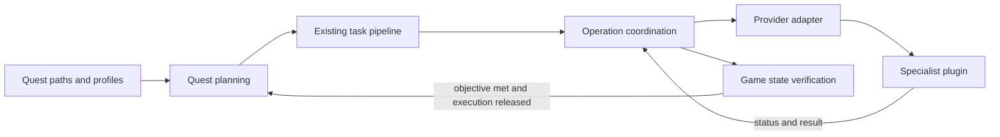

# Questionable orchestration overhaul

## Current status (2026-11-01)

The overhaul is incomplete. This plan owns current scope, remaining work and acceptance checks. [DELEGATION-AUDIT.md](DELEGATION-AUDIT.md) owns the dated implementation history, original findings, test counts, hashes and evidence. Historical findings are not automatically current defects, and passing tests describe only the source snapshot tested.

Questionable decides what a quest needs, delegates supported execution and verifies the result. Preserve existing quest paths, profiles and supported behavior. Reuse existing provider APIs; a richer or more uniform API alone does not justify changing another plugin. Companion changes need a concrete gap that cannot be handled safely within Questionable. The recorded Gather, AutoHook and solo-duty changes were authorized exceptions.

Working dialogs remain outside cleanup scope. The user confirmed quest startup works after the earlier repair. Further fishing work and Feesh integration remain parked until the actual IPC details are available; retain the existing Gather and AutoHook source work. SmartNav and wholesale SimpleMove migration also remain parked for the contract/cancellation gaps below.

| Area | Implemented state | Verification and remaining limits |
| --- | --- | --- |
| Crafting | Existing Artisan lists or recipe fallback, verified quantities/quality, sequence-scoped list targets and persistent local ownership. | Automated checks recorded in the [crafting audit](DELEGATION-AUDIT.md#crafting-verification-update); native execution and recovery still need the live checklist. Unknown custom list-only routes retain their compatibility warning. |
| Purchasing | Knightshopper operation identity, inventory-total verification, bounded status/cancellation waits and protection of manual travel. | [Purchasing audit](DELEGATION-AUDIT.md#purchasing-implementation-update); live cancellation, provider loss and shop failure cases remain pending. |
| Gathering and fishing baseline | Gather API 2 with transient companion requests; AutoHook owned fishing API v1 source work retained. | [Stage 3 record](DELEGATION-AUDIT.md#stage-3-gathering-and-fishing-2026-11-01). Companion binary updates/reloads and live validation were deferred. Feesh remains parked. |
| Duties and combat | Ownership spans tasks; encounter routing/targets moved to BossMod. QST retains entry, difficulty, unlocks, outcome checks and retry. Latest change uses direct preset activation, with NormalMovement for Pâtisserie (CFC 1045); seven duty modules remain and the capability endpoint/support files are removed. | [Direct preset update](DELEGATION-AUDIT.md#direct-preset-simplification-2026-11-01): BossMod.Modules Release passed; QST Release and focused tests were blocked before compilation/execution by the ImageSharp 4.1.2 Six Labors license requirement. Older suite, capability-harness and hash results do not validate this update. No new Boss core IPC or module-pack revision is required. |
| Navigation | Bounded pathfinding, arrival/failure checks, provider travel barriers, failure snapshots and optional vnav status reads. | [Navigation record](DELEGATION-AUDIT.md#navigation-verification-2026-11-01); native landing, range and zone-transition cases need reproduction/validation. |
| Simplification | IPC wrappers/lifecycle, controller scheduling, crafting startup, title-bar rendering, navigation test setup and shared test clock cleaned up. | [Latest test-clock checkpoint](DELEGATION-AUDIT.md#shared-test-clock-cleanup-2026-11-01): 9,470 passed in its isolated mirror. Concurrent BossModIpc/SinglePlayerDuty edits were excluded; this is not a passing result for the entire current tree. |

## Outstanding issues and parked work

This table is the remaining-work index, not authorization for further runtime changes. Diagnose specific reports and preserve working behavior; do not reopen a completed cleanup solely to impose another abstraction.

| Item | Evidence / next check |
| --- | --- |
| Premature quest acceptance or turn-in completion | The [missing-return fix](DELEGATION-AUDIT.md#reject-stale-sequence-completions-2026-11-01) prevents stale-sequence completions from advancing the current sequence. Its regression tests passed, but the user's live symptom is not confirmed resolved. Capture the quest, sequence/step and logs when it recurs during the level 1–100 playthrough. |
| Combat after interrupted conversation | Acceptance/turn-in waits now permit damage interruption through the existing combat/replay path. [Managed regressions passed](DELEGATION-AUDIT.md#quest-acceptance-and-turn-in-damage-interruption-2026-11-01); live provider activation remains unverified. The separate early combat-flag timing gap remains unresolved. The user reported this with any selected provider while QST kept Running. |
| Latest direct preset change | Resolve the recorded build prerequisite before claiming QST validation; then verify the updated activation tests and current source. Preserve historical results as historical evidence. Gameplay handoff/outcome checks remain pending. |
| Navigation | Reproduce landing, interaction-range and zone-transition failures separately, using LastNavigationFailure and the current quest/task. Preserve mounting, landing/dismount, quest jumps, mesh workarounds and stuck recovery until equivalent coverage exists. |
| SmartNav / SimpleMove | SmartNav source and IPC contract are unavailable in the recorded review. Agree its boundary with Lifestream before migration. SimpleMove remains parked because Path.Stop does not cancel a pending request that can later dispatch. |
| Feesh / fishing | Wah reported IPC ready for testing and planned default protection for fish needed by unfinished quests plus an exclusion parameter. This is not a verified contract. Obtain actual endpoint names, signatures, supported build and exclusion/ownership behavior before resuming. Verify coverage: 21/33 targets catalogued, 12 missing, including all eight collectible targets. Fish ID plus additional quantity is only a candidate request. The recorded obsolete WaitAtEnd stop and unused AutoHook wrappers stay parked too. |
| Original adapter findings | Lifestream acceptance/cancellation, Stylist rejection/unload/preference fallback, and conflict-setting/readiness findings remain candidates for a fresh targeted review, not confirmed current defects. See the audit's original tables. Working dialogs remain excluded. |
| Existing contract limitations | Artisan has no remote operation/session identity or terminal scoped cancellation; its local guard cannot survive QST unload. Legacy Gather stop is global. AutoDuty/BossMod cannot detect reloads between observations. Purchasing cannot confirm cancellation after QST unload. Do not claim these limits are solved by local ownership tracking. |
| Deferred scope | Unknown custom craft lists lack independently verified outputs; delivery groups require exact selection. Material procurement is not part of the crafting pilot. Mogmail remains disabled pending separate justification and a complete contract. |

Pâtisserie is historical seasonal-event coverage and unavailable in the recorded review. Its metadata fixture proves mapping, not playability. It is excluded from the current gameplay checklist and final overhaul gate; no return date is assumed.

## Responsibilities

| Area | Questionable retains | Intended execution owner |
| --- | --- | --- |
| Quest progression | Quest selection, profiles, prerequisites, step order, skip conditions, dialogue choices, objective verification | Questionable |
| Crafting | Required quest outputs, quality requirements, selection of an existing quest list or recipe fallback, final inventory checks | Artisan: list execution, subcrafts and synthesis |
| Gathering | Required quantity and collectability, quest restrictions, final inventory checks | Gather n Chill: gathering plan, travel and execution |
| Shopping | Requested inventory total and existing purchase constraints, final inventory checks | Knightshopper: shop selection, travel and purchase |
| Fishing | Quest requirements and completion checks | AutoHook remains the historical baseline; provider selection/integration is parked pending Feesh IPCs and contract/coverage verification |
| Travel | Destination and quest-specific access conditions, arrival verification | Existing vnavmesh/Lifestream execution; SmartNav remains a future owner after contract and boundary verification |
| Duties and combat | Quest/duty eligibility, entry, difficulty, unlocks, provider selection, outcome verification and retry | AutoDuty for supported duties; BossMod for solo encounter routes, targets and mechanics; rotation providers for their supported roles |
| Dialogue and gear | Quest-specific choices, gear requirements and user preferences | TextAdvance and Stylist for supported execution; retain necessary local interactions |
| Conflict suppression | Which automation conflicts with the current operation | Scoped setting changes through YesAlready/Pandora integrations, restored by the owner |

Native NPC interaction, quest flags, item use and other quest-specific game actions stay local where no suitable provider exists. Delegating everything is not a requirement. Mogmail remains disabled pending a separate justification and complete contract.

## Boundaries in the code

The current `TaskCreator` expands a step by running registered factories in order. `MiniTaskController` executes the resulting queue. Provider starts, waiting, inventory checks and cleanup are spread across executors, controllers and IPC adapters. Some operations already span multiple tasks, including duties.

Retain the existing task pipeline and these responsibilities:

1. **Quest planning:** translate existing quest data into an objective and prerequisites. Preserve factory ordering and existing local tasks initially.
2. **Operation coordination:** track submitted work independently of the executor currently on the queue. Decide whether replacement work may start, request cancellation where the existing API supports it safely, and retain unresolved cleanup.
3. **Provider adapters:** translate domain requests and provider responses. Keep wire formats, version checks and provider-specific errors here.
4. **Outcome verification:** evaluate inventory, quality, quest state or destination using game state. Provider success alone does not advance a quest.

Crafting and purchasing supplied the concrete lifecycle use cases. Keep the existing shared ownership helper and provider-specific states where their contracts differ; do not replace all executors with a generic provider framework or add a dependency for this cleanup.

Use `TaskQueue` for pending/current local tasks, with external ownership held separately. Gate every replacement path in `MiniTaskController`, including normal dequeue, retry, interruption replay and skip-to-final-task. Keep cancellation reconciliation running before `QuestController` returns early for stopped automation or an occupied player; otherwise stopping quest execution also stops cancellation acknowledgement checks.

## Optional operation capabilities

Use these capabilities where a provider already exposes them. They describe possible richer APIs, not a required common contract or a companion-plugin work list. Their absence does not block normal crafting: required inventory plus stable Artisan idle is sufficient. Existing stop/recovery guards remain appropriate for cases the current API cannot resolve automatically.

| Part | Meaning when supported |
| --- | --- |
| Capabilities | API version, provider session identity, supported request types, status/cancellation support. Installed, available and busy are different facts. |
| Request identity | Questionable creates a stable request ID for a single attempt, tied to character, quest, sequence and objective. A repeated submission with that ID must not start duplicate work. |
| Acceptance | Explicit accepted, busy, unsupported, invalid or unavailable result. Accepted returns a provider operation ID and the provider session identity. A void call means only submitted. |
| Status | Queued, running, paused, cancelling, succeeded, failed or cancelled, with an operation-specific reason. Unknown/unavailable must not become idle or success. |
| Completion | Successful status means the provider released its execution resources. Questionable then verifies the objective before advancing. If a provider separates result and cleanup, both must be observed. |
| Cancellation | Cancel only the identified operation, idempotently. An accepted cancellation request is not a terminal acknowledgement. Pausing is not cancellation. |
| Cleanup ownership | Temporary settings and child work belong to the operation. Prefer provider-side restoration and owner-loss handling; Questionable restores only changes it actually owns. |

Record local submission before calling the provider. If submission throws after potentially reaching it, reconcile through request lookup when available instead of retrying or falling back. Without request lookup/idempotency, retain the local guard and require safe-state confirmation. Automatic recovery from this ambiguity is not a prerequisite for the crafting pilot.

Quantity semantics must be explicit per adapter. Prefer desired inventory totals in crafting intents, with quality requirements per item. Translate to missing quantities or synthesis counts only where the provider contract requires it. A resolved plan must distinguish final outputs from intermediate materials and account for recipe yield.

## Lifecycle and failure policy

Normal flow is determine the required outputs, select existing provider work, submit, observe execution, verify the outputs and stable idle, then complete. Use explicit acceptance and completion responses where available. Already-satisfied objectives can finish before submission. Verification can observe progress while work runs, but must not release ownership early while the provider still operates.

Stop, skip, retry, death, interruption, profile changes and path reloads all use the same ownership rules. Stop removes the intent to continue immediately; cleanup continues while the plugin is loaded. Skip and retry cannot start replacement work until conflicting execution has been released. A task finishing or disappearing from the queue does not erase the provider operation.

Use separate bounded waits for submission, startup, unavailable status, cancellation and verification. Long crafting runs or duty queues need progress-aware policies, not a single universal timeout. A timeout stops automatic scheduling and explains the unresolved state; it does not prove that the provider stopped.

Provider session changes invalidate old handles. Never send a stale cancellation to a newly loaded provider or claim a new manual job. Reconcile through an explicit provider contract where available; otherwise require a confirmed safe state before automatic restart. Do not persist raw handles and replay them across Questionable restarts.

Keep game reads and provider calls on the appropriate framework thread without blocking it. Preparation that can run elsewhere should return immutable results for that thread. During plugin unload, attempt cancellation before disposal only where the existing API supports it safely; do not wait indefinitely for framework ticks that may cease. Local disposal cannot guarantee cleanup after caller loss. Document that limitation without making a new provider-side watchdog a prerequisite for ordinary quest execution.

## Exclusive execution and user settings

Use one top-level delegated operation controlling the player. Purchasing and gathering include travel, so Questionable must not start its own navigation alongside them. SmartNav or another child used internally by that provider belongs to the same ownership chain. Do not send competing direct commands to the child.

Check stop paths as well as start paths: an unconditional local navmesh stop during a step transition can interrupt travel owned by Knightshopper or Gather n Chill. The execution barrier coordinates Questionable's requests; it cannot prevent unrelated plugins or manual actions from taking control.

Existing combat combinations remain behind their current coordinator. Do not introduce a general concurrent scheduler. Any future composition must identify who owns movement, targeting and rotation before allowing overlap.

Changing a provider preference applies to the next operation; cancellation still targets the provider that accepted the current one. Manual takeover should stop automatic continuation. Snapshot temporary settings once, and avoid overwriting a later user change during restoration. Preserve failed restoration obligations within the correct provider session, with a visible unresolved state.

Fallback is permitted after a definitive unsupported or missing-plan response, before any work was accepted. Busy, uncertain submission and lost status never trigger a second provider or recipe request.

## Crafting behavior to preserve

Use Artisan's existing list and recipe APIs. Eligible whole lists require a contiguous, unambiguous crafting block, verified final outputs and matching native quest metadata. Verify every required output's count and quality plus stable provider idle. Intermediate crafts do not trigger a whole list; a fully satisfied final-output group can skip later subcrafts. Missing or unsuitable lists retain the supported recipe fallback; busy, uncertain or lost submissions do not trigger fallback.

All ten shipped list-only routes now have verified sequence-scoped requirements. Unknown custom list-only routes retain prior compatibility behavior and a warning: observed busy-to-idle is not independently verified output. Practical Needs (WVR 590) retains recipe fallback because the inspected catalogue lacks a dedicated list. Saved catalogue contents do not prove live provider availability. Do not start a whole Crystarium, Studium or Wachu delivery group for one quest without exact selection.

Artisan's recipe API cannot guarantee HQ; Questionable verifies the produced quality. Its stop request pauses lists and is not terminal cancellation. Preserve the local stop/recovery guard without claiming remote ownership or caller-loss cleanup. No Artisan API expansion or recursive material-procurement system is required for this scope. See the [crafting history](DELEGATION-AUDIT.md#crafting-verification-update) for the requirement audit and implementation evidence.

## Completion gates

The original implementation order is retained in the audit. Current completion depends on resolving the outstanding items above and validating the supported behavior below, rather than repeating completed migrations.

- Preserve objective verification, stable release of execution, manual jobs and user settings across normal completion and interruption.
- Use version/capability checks required by the actual provider contract, not a mandatory new endpoint for every provider. BossMod uses existing preset IPC directly. AutoHook's retained implementation requires owned API v1 for unmet objectives and has no legacy execution fallback.
- A compatibility path may be selected only for future work after active work settles; never start duplicate execution beside an unresolved operation.
- Remove replaced code or workarounds only when no callers depend on them and equivalent behavior is covered. Companion changes require a demonstrated gap and narrow scope.
- Use isolated automated checks for each implementation slice. Native/UI/IPC behavior still requires the final level 1–100 playthrough. Alt testing has begun; the full live checklist remains pending.

## Acceptance checks

Use deterministic fake-provider tests for lifecycle decisions throughout implementation and targeted in-game checks for actual IPC and game behavior during final validation.

| Scenario | Required result |
| --- | --- |
| Provider busy or paused with a manual job | Reject the new request without modifying or resuming the manual job. |
| Start throws after possible acceptance; a retry is attempted | Reconcile through the existing API when supported, otherwise retain the local guard; no duplicate execution or fallback. |
| Stop or skip immediately after submission | Use supported cancellation or retain the existing manual recovery guard; replacement work does not start while execution is unresolved. |
| Cancel is rejected, times out, or throws | Local automation stops; unresolved ownership remains visible; no false stopped status. |
| Provider unloads/reloads or Questionable restarts | Old handles are not reused; manual work is preserved. Observed Artisan loss during a tracked run requires reconciliation; loss between observations and ownership loss across Questionable unload remain documented limitations. |
| Provider succeeds with too few items or wrong quality | Verification fails; the quest does not advance. |
| Provider creates extra subcrafts or skips missing recipes | Only required final outputs satisfy the objective. |
| Task/step changes during a multi-task operation | Ownership survives until explicit completion or cancellation. |
| Profile/path refresh or death during execution | No duplicate submission; replacement work waits for release. |
| Purchase or gathering provider is travelling | Questionable does not concurrently issue navigation. |
| User changes a setting/provider mid-run | Cleanup targets the original owner and preserves subsequent user choices. |

Build/test only in an isolated source copy using the configured Dalamud library path. Do not replace the game-loaded DLL during development checks. During final in-game validation, record provider version, quest, expected behavior and observed result for each pilot; unit tests do not substitute for those checks.

Normal UI should explain the action, provider and next step: “Crafting with Artisan”, “Waiting for Artisan to stop”, or “Artisan disappeared; check its work before restarting”. Keep request IDs, session IDs and transitions in diagnostic logs/debug views.

## Pending live validation

Record provider version, quest, expected behavior and observed result. The user-confirmed startup repair is evidence for startup only; it does not close later duty handoff, combat or completion checks.

- **Crafting:** finish an item-target and a legacy list-only craft; verify CRP 139's three shields, CRP 141's two outputs, CRP 538's full group, CRP 539's separate stages, a three-dish HQ list and CUL 268's intermediate handling. Check NQ inventory against an HQ requirement, ALC 648's three HQ potions and Namazu HQ products. Stop/skip and attempt immediate quest or gathering restart; paused/queued work must not be acknowledged. Observe Artisan unload/reload and recovery confirmation, including with no selected quest and a minimized window.
- **Purchasing:** purchase the missing quantity to the requested inventory total, preserve a manual Knightshopper job, stop during travel and at the shop, exercise cancellation refusal/provider loss and late completion after abandonment, and check insufficient gil/full inventory without false completion.
- **Gathering/fishing baseline:** validate final quantity/quality, manual takeover and stable-idle recovery against the intended companion builds. This checklist does not resume parked fishing implementation or authorize deployment/reloads.
- **Duties/combat:** verify supported entry, correct requested instance, provider activation, interrupted acceptance/turn-in recovery, outcome/retry and settings restoration. Pâtisserie is excluded as described above.
- **Navigation:** verify native landing/takeoff, short-route arrival, interaction range, loading/zone transitions and provider-owned travel. Recheck the original same-zone teleport step without a position.
